# ¡Hola! Soy Ángel David Avirama

### Estudiante de Ingeniería de Sistemas · Full Stack Developer · Data Science Enthusiast

Noveno semestre en la <strong>Universidad de Medellín</strong>. Me interesa construir aplicaciones web, desarrollar soluciones backend y explorar el potencial de los datos y el aprendizaje automático.

---

## Sobre mí

Soy estudiante de noveno semestre de Ingeniería de Sistemas en la Universidad de Medellín. Me interesa participar en el ciclo completo de desarrollo de software: comprender problemas, diseñar soluciones, construir interfaces, desarrollar APIs, integrar bases de datos y desplegar aplicaciones.

He trabajado en proyectos académicos y colaborativos de desarrollo Full Stack, infraestructura cloud y Machine Learning. Disfruto aprender nuevas tecnologías, resolver problemas y trabajar en equipo para convertir ideas en soluciones útiles.

- 🎓 **Formación:** Ingeniería de Sistemas — Universidad de Medellín.
- 💻 **Interés principal:** desarrollo de software y aplicaciones web Full Stack.
- 📊 **Interés complementario:** ciencia de datos y Machine Learning.
- ☁️ **Experiencia en proyectos:** APIs REST, bases de datos y despliegues en AWS.
- 🏆 **Reconocimiento:** ganador de la Feria del Software 2025 de la Universidad de Medellín con Tramix.

## Tecnologías y herramientas

### Lenguajes

### Frontend

### Backend y bases de datos

### Cloud, DevOps y herramientas

### Ciencia de datos

  
  
  
  
  
  

## GitHub

---

**Gracias por visitar mi perfil. ¡Conectemos y construyamos algo interesante!**

